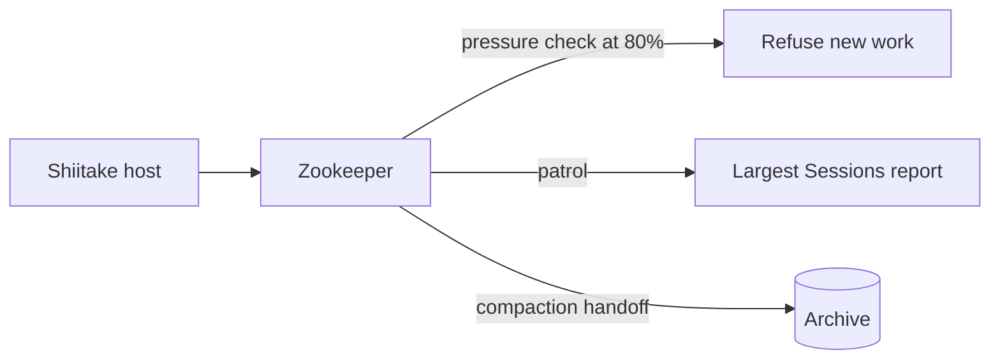

# Zookeeper (`@fungi.computer/zookeeper`)

Zookeeper keeps the storage of an agent host within its size limit. It refuses
new work when storage nearly fills, finds the biggest conversations, and
archives history that gets trimmed.



## Quick start

Install it, then watch the pressure check flip. Run this with Node 24.

```sh
npm install @fungi.computer/zookeeper
```

```ts
import { openStoragePressure } from "@fungi.computer/zookeeper";

let used = 700;
const check = openStoragePressure({ usedBytes: () => used, budgetBytes: 1000 });

console.log(check.underPressure()); // false (70%)
used = 800;
console.log(check.underPressure()); // true (80%)
used = 760;
console.log(check.underPressure()); // true, until usage falls below 75%
used = 740;
console.log(check.underPressure()); // false
```

It prints `false`, `true`, `true`, `false`.

## Common tasks

### Refuse work near the limit

`openStoragePressure` is the check you pass to Shiitake's `storagePressure`
option. See the Quick start.

### Find the largest Sessions

`openPatrol` reads one page of Sessions per pass. See
[Storage pressure](#storage-pressure).

### Archive what compaction drops

`zookeeperCompaction` is the handoff extension. See
[Storage pressure](#storage-pressure).

## Reference

### Overview

Zookeeper keeps a Shiitake host's Durable Object store within its storage
budget: a pressure check that refuses new work near the limit, a patrol that
finds the largest Sessions, and archiving when compaction drops history.
Oyster's Shiitake host uses it. Storage and memory limits belong here, never in
Shiitake core.

## Install

```sh
npm install @fungi.computer/zookeeper
```

## Storage pressure

`openStoragePressure({ usedBytes, budgetBytes })` returns the host's
`StoragePressureCheck` for Shiitake's `storagePressure` option. It reports
pressure at 80% of the budget and keeps reporting it until usage falls below
75%, so admission does not flap at the threshold. Shiitake keeps the refusal
door and the typed `storage_pressure` error; Zookeeper owns the numbers.

An invalid budget throws a `contract`/`invalid` `ShiitakeError` when opened. An
unreadable measurement throws a `store`/`unavailable` `ShiitakeError`, which
refuses the new work.

Zookeeper is Shiitake-only. Pi Durable hosts are out of scope.

`openPatrol({ budget, readColdSessions, report })` returns host work for
Shiitake's `hostWork`. Its synchronous `pending` reads only the platform's size
of the store: `nextWakeAt` is `null` while the store is under the waterline
(half the budget) and a time at least a second ahead (five minutes by default)
while it is over. Its `run` is one bounded pass: when the store is over the
waterline it reads one page of Sessions, skips a Session whose bytes are unknown
or whose row cannot be read, and hands the host a typed `PatrolReport`. It
evicts nothing.

`zookeeperCompaction({ writer })` is the compaction handoff extension over a
host-bound `ArchiveWriter`; the host appends it and `zookeeperCompactionGrant`
to its roster. It archives what leaves the model context (the history and
turn-prefix messages, not the summary), returns the writer's receipt as the
opaque `accepted` receipt, and answers `discarded_by_policy` only when nothing
leaves the context. A writer failure is a handoff failure, so compaction stops
with the prior context intact; it is never a discard.

## Examples

The [Quick start](#quick-start) above is the maintained example.
